<p align="center">
  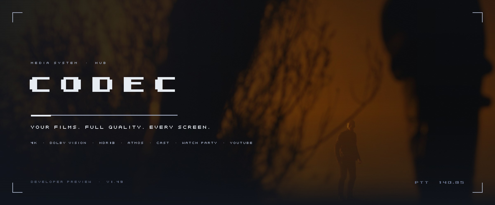
</p>

<p align="center">
  <a href="../../actions/workflows/build.yml"></a>
  
  
  
  
  
</p>

<h3 align="center">Your films, at original, consistent quality. Experience your library like never before. Accessible remotely for you and friends to watch together online, without compromises.</h3>

<p align="center">
  <a href="#build-from-source"><b>Build from source</b></a> &nbsp;·&nbsp;
  <a href="docs/FEATURES.md"><b>Every feature</b></a> &nbsp;·&nbsp;
  <a href="docs/ENGINEERING.md"><b>Engineering notes</b></a> &nbsp;·&nbsp;
  <a href="#status"><b>Status</b></a> &nbsp;·&nbsp;
  <a href="docs/DEVELOPMENT.md"><b>Developer guide</b></a> &nbsp;·&nbsp;
  <a href="CHANGELOG.md"><b>Changelog</b></a>
</p>

<p align="center">
  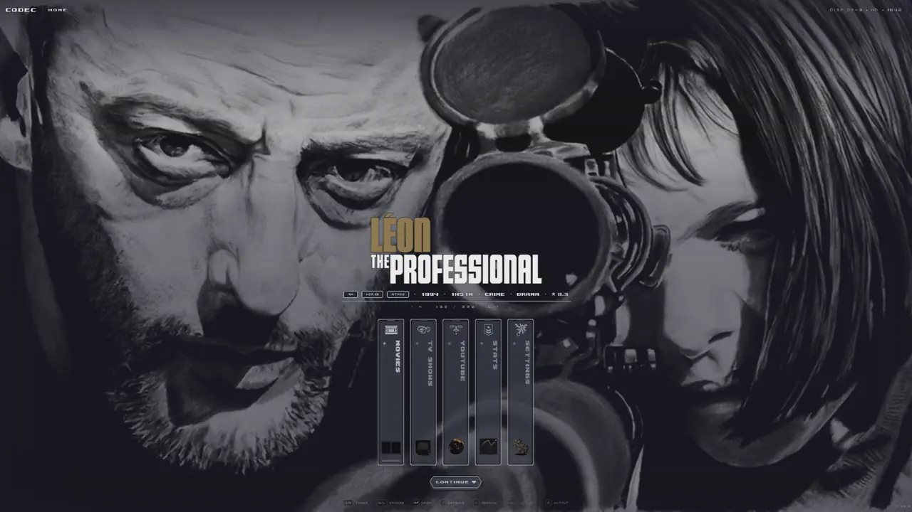
</p>

**codec is a private cinema for the films on your own disks.** It plays your
library at the quality it was mastered in, compatible with true 4K **Dolby Vision and HDR** on your
television through its pre-loaded Google Cast receiver (no software install needed), brings friends anywhere into a
synced **watch party** from a single link, and compatible with **YouTube**, with or
without a Google account.

Built with Qt 6 and QML on
libmpv, and made for desk or couch configurations, due to supporting keyboard, TV remote or mouse inputs.

> [!NOTE]
> **codec is a developer preview.** It was built for myself over four
> months (976 commits, 66 releases) and is now still in development. It builds
> and runs on Arch, Fedora and Debian; expect rough edges outside the setup it
> was developed on (for now). If attempting to install the pre-release, here is where each feature stands: **[Status](#status)**.

<table>
  <tr>
    <td align="center" width="25%"><h2>24 / 24</h2>Dolby Vision titles cast at full bitrate</td>
    <td align="center" width="25%"><h2>4</h2>cast lanes, chosen film by film</td>
    <td align="center" width="25%"><h2>1</h2>link to bring a friend into the room</td>
    <td align="center" width="25%"><h2>0</h2>apps to install on the television</td>
  </tr>
</table>

## Table of contents

- [What makes it different](#what-makes-it-different)
- [Engineering highlights](#engineering-highlights)
- [Visual style](#visual-style)
- [Your collection](#your-collection)
- [Dolby Vision & HDR](#dolby-vision--hdr)
- [Casting](#casting)
- [Watch party](#watch-party)
- [YouTube](#youtube)
- [Subtitles](#subtitles)
- [Made for any viewing configuration](#made-for-any-viewing-configuration)
- [The queue](#the-queue)
- [Settings](#settings)
- [Hub & satellites](#hub--satellites)
- [Under the hood](#under-the-hood)
- [Status](#status)
- [Build from source](#build-from-source)
- [Keys](#keys)
- [FAQ](#faq)
- [Roadmap](#roadmap)
- [Contributing](#contributing)
- [About](#about)
- [Credits and legal](#credits-and-legal)

## What makes it different

- **The picture quality is never the compromise.** A Dolby Vision film reaches the TV as the studio's own Dolby Vision stream, not re-encoded. An HDR10 film stays HDR10. codec reads each film and picks the path that keeps it intact.
- **Pre-loaded with a custom casting receiver.** The TV runs codec's Cast receiver, so it shows codec's visual overlay, plays Dolby Vision, and answers its own IR television remote. Nothing to install, nothing to sign into, no predatory monetization.
- **A party for people who care about the cinema experience.** Guests get codec's web player overlay, playback in sync with the host's machine, and a guest's 4K TV can join in HDR or Dolby Vision. Each guest climbs only as high as their device can decode, so nobody stutters.
- **Unique visual direction.** Pixel art on an integer-scale grid, stylish fonts extended to accommodate additional characters. No Chromium wrapper, visuals painted by hand and in native QML.
- **No server to babysit, no accounts.** One host machine holds the library; others join it with an on-screen yes. A laptop takes the library on the road, accessible anytime (internet required for non-local files), and still plays the hub's files at full quality.

## Engineering highlights

<sup>[(Back to top)](#table-of-contents)</sup>

codec's hardest bugs rarely matched their first explanation. A few of the stories, told in full in **[docs/ENGINEERING.md](docs/ENGINEERING.md)**:

| Seen | What it really was |
|---|---|
| A Dolby Vision cast **buffered more and more towards the end** of a long film | The manifest's timeline was extrapolated from the first few segments, 0.4 % short, and **31 seconds off by hour two**. The player trusted it, and its real cushion drained. Now sized to the film, exact once known; held 20 s of buffer for 25 minutes straight |
| DV casts **stuttered on marginal wifi**, and the brief was full bitrate, no transcode, same wifi | Not throughput: 10-second GOPs made 150 MB segments against a buffer that held one. A deeper buffer the Cast SDK doesn't expose (but merges), sized per film to fit the TV's memory, plus parallel 2-second pieces: **24 of 24 DV titles at full bitrate** |
| A guest's phone flickered on HDR films. **"It's the tone mapping"** | The tone mapping was bit-identical. A scope film's "1080p" rung is really **2542×1080 at H.264 level 5.0**, past the phone's hardware decoder, and the page rebuilt itself on every error. Now each rung is checked with the browser's own `decodingInfo` first |
| The screen flickering, **"only on codec"** | An idle-rendering optimisation dropped codec to ~1 fps, under the FreeSync panel's 48 Hz floor. Steady frames only while adaptive sync is engaged, and a FRAME RATE setting |
| UI sound effects made **start-up lag** | Qt Multimedia loaded its FFmpeg backend on the GUI thread: a 1.4 s stall, CUDA, +130 MB. Replaced by a 12-voice mixer on one native PipeWire stream |
| The hub sent `Access-Control-Allow-Origin: *` | **Any web page on the network could have read its internet token.** Now a gate: own-Host check against DNS rebinding, origin-scoped media, paired devices with hashed keys |

<br>

<a id="visual-style"></a>
<p align="center">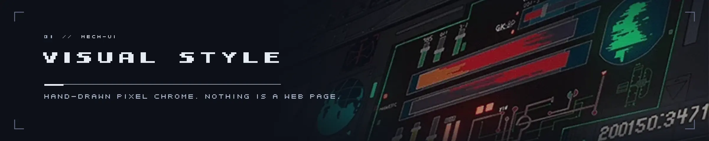</p>

<sup>[(Back to top)](#table-of-contents)</sup>

**Every plate, bar and badge is pixel art, and it only ever scales in whole steps, so it never blurs.** The type is *Metal Gear Solid*'s own "codec" and "HUD" font faces, extended from the game's handful of glyphs to full Latin and a symbol set.

<!-- MEDIA: a short clip of the wheel turning and the synopsis decoding. -->
<p align="center">
  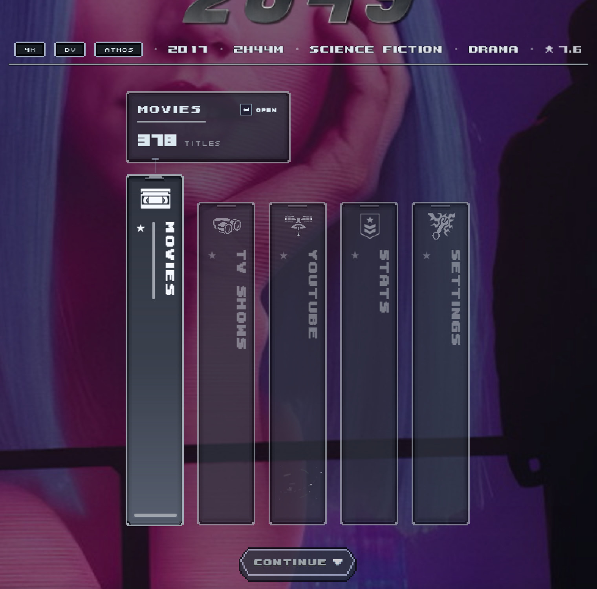
  <br>
  <i>Up close, at 2×: badges, the readout card, the wheel. Every edge sits on the pixel grid.</i>
</p>

| | |
|---|---|
| 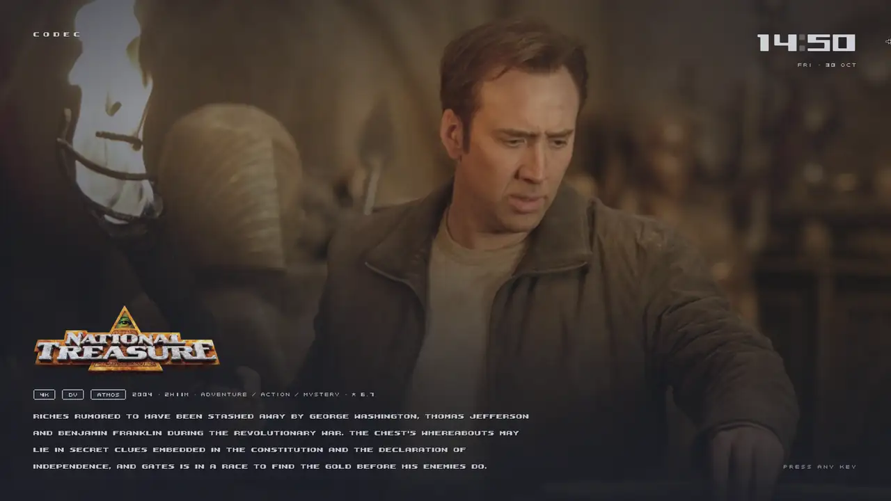 | 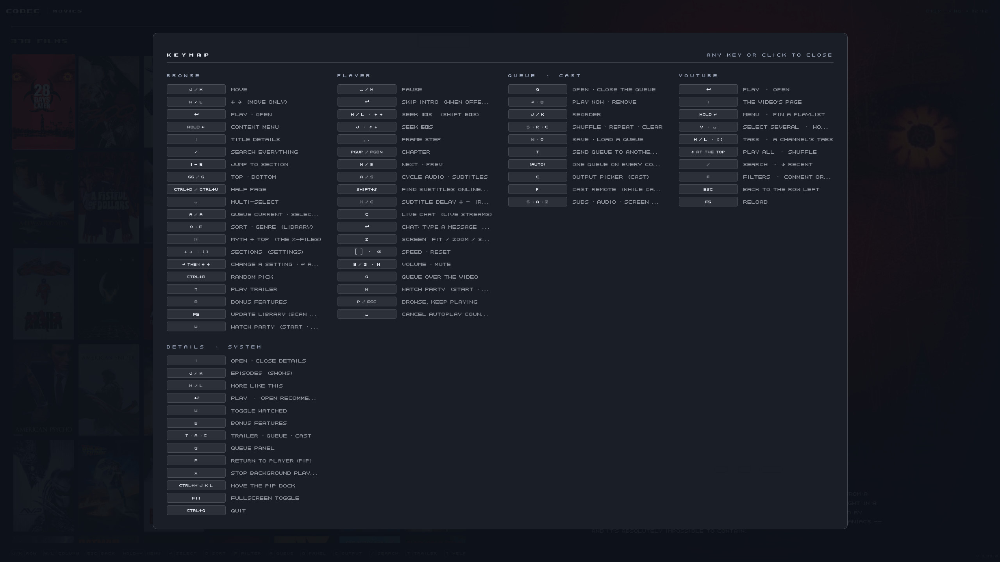 |
| **Attract mode.** When the room goes quiet, codec runs its own demo loop: a clock in the codec face, the synopsis decoding, new arrivals first. | **One key, one answer.** `?` lists every key on the screen you're on, in keycaps drawn to match. |

- **Mech-UI**: 9-slice pixel plates, a fixed steel palette, and an integer-scale law, measured down to a CRT's visible glass
- **Optical alignment**: every badge, in the app and on the web, follows one measured rule for consistent alignment on elements.
- **The MGS1 Codec & HUD fonts**, extended to Latin-1, Latin Extended-A and symbols ([docs/fonts](docs/fonts/README.md))
- **UI sounds** through one native PipeWire stream, hushed while a film plays
- **A garage editor** (experimental): a live, Armored Core-style rig with about 200 dials for every plate, glow and ink, used for fine-tuning visuals.

<br>

<a id="your-collection"></a>
<p align="center">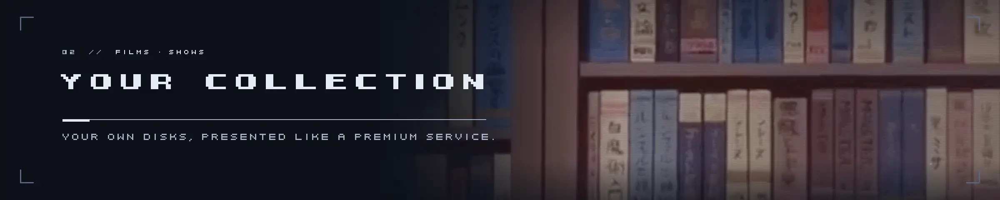</p>

<sup>[(Back to top)](#table-of-contents)</sup>

**Your own disks, presented like a premium service.** Posters, backdrops and clearlogo title art from TMDB and fanart.tv. Every badge, from **4K** and **DOLBY VISION** to **HDR10**, **ATMOS** and the cut, is read from the file metadata itself.

<p align="center">
  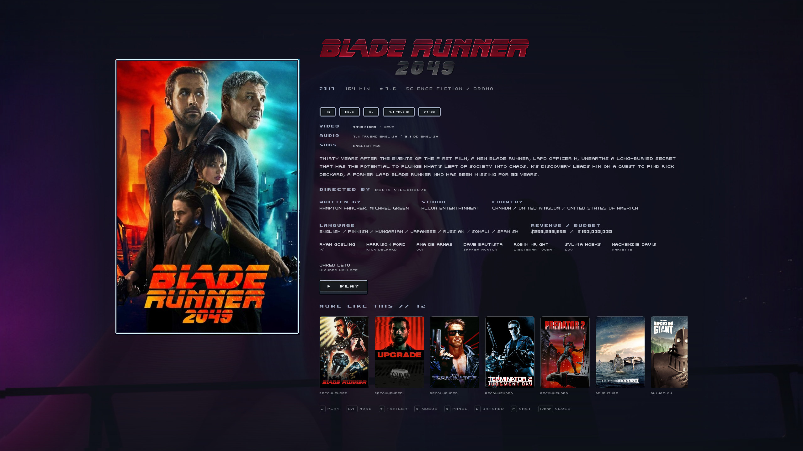
  <br>
  <i>A film's dossier: the badges come from probing the file.</i>
</p>

| | |
|---|---|
| 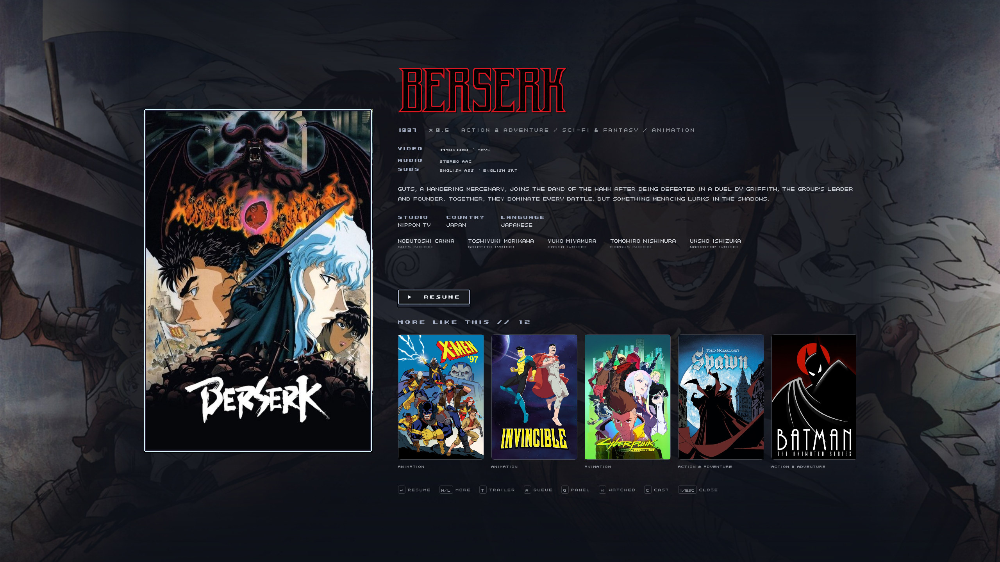 | 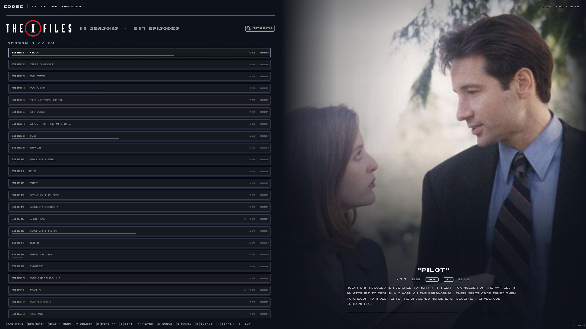 |
| **Shows** get a page of their own, with the next episode up and every episode's own air year. | **Viewing guides.** A fan's map of a long show, like *The X-Files*' mythology arc, re-cuts the episode list, and autoplay follows it. |
| 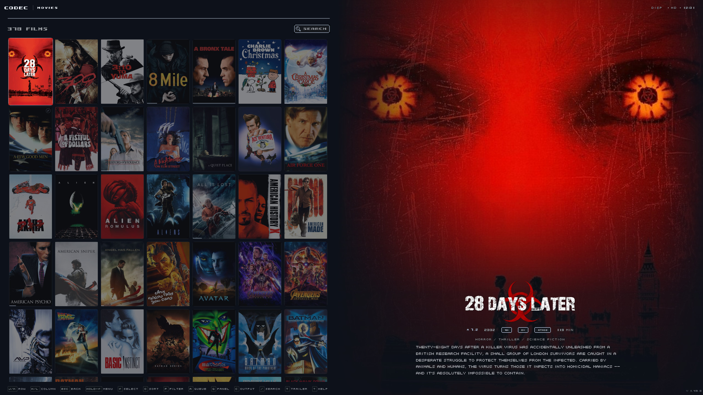 | 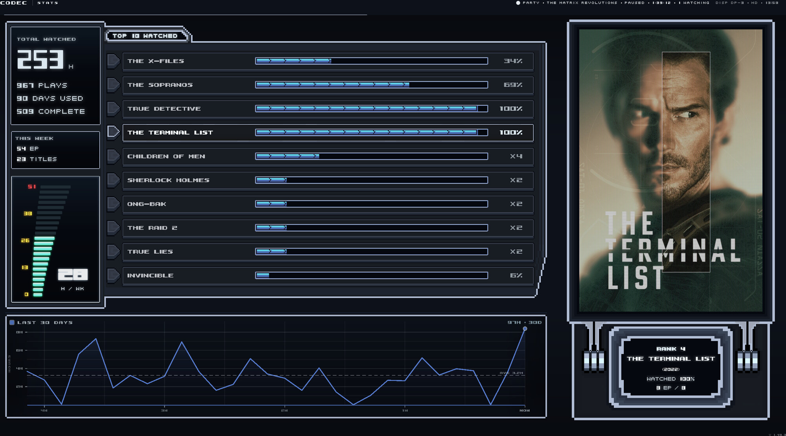 |
| **The grid**: every film, the selected one large, with filters, sorts and search. | **STATS**: what you watch, ranked and graphed in a cockpit of its own. |

- **NEW** on anything that arrived in the last two weeks that nobody has started
- **Resume everywhere**, with each film's audio and subtitle choice remembered
- **SKIP INTRO** and **UP NEXT** at the credits, from detectors that scan the library while you sleep
- **Bonus features and audio commentary**: every extra a film or show carries, grouped, with thumbnails from their own frames, to enjoy the "making of" your favorite media.
- **The library watches your disks** and updates itself; an **audit** probes every file against what the library claims it to be, providing confident quality.
- **Wide format compatibility** including 5.1–7.1 surround sound: HEVC, AV1, TrueHD, DTS, DD+, PGS

<br>

<a id="dolby-vision--hdr"></a>
<p align="center">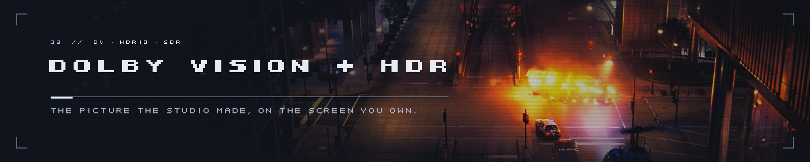</p>

<sup>[(Back to top)](#table-of-contents)</sup>

**The picture the studio intended you to see, on the screen you own.** On your desktop, codec hands HDR straight to a compatible display. On a television it reads the film and picks its lane:

| Lane | What it does | Used for |
|---|---|---|
| **Dolby Vision** | The film's own profile 8.1 stream, copied into DASH. **Not re-encoded.** | DV films on a DV television |
| **HDR10 / HEVC** | Hardware transcode on the GPU (NVENC, 10-bit HEVC), PQ kept end to end, frames at their own size | HDR10 films, other HEVC, very large SDR |
| **SDR ladder** | Adaptive rungs, tone-mapped once on the GPU, zero copies | SDR films, party guests' browsers and phones, slow links |
| **Direct play** | The file as it is | MP4 / WebM in H.264 or VP9 with a TV-friendly audio track |

<p align="center">
  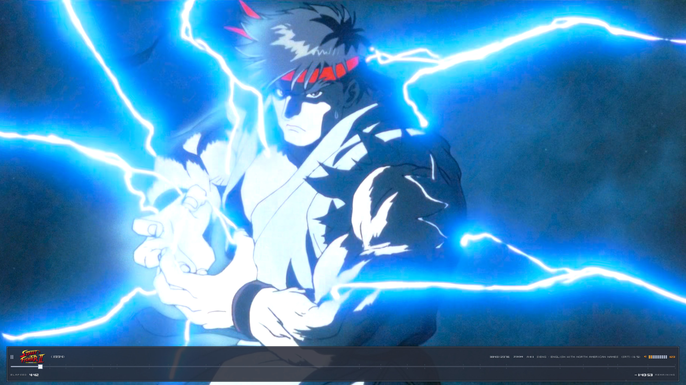
  <br>
  <i>Playing locally: the OSD wears the film's title logo, with auto-applying screen mode preferences based on the title or display output. Audio tracks, volume and quality readouts at a glance.</i>
</p>

- **Every Dolby Vision title in the library casts at full bitrate**: 24 of 24, and 139 of 139 others, checked by eye and by the receiver's own dropped-frame counts
- **Profile 7 discs** become profile 8.1 losslessly; irregular-GOP Dolby Vision is re-encoded to a clean copy, verified, the original never touched.
- **Optional adaptive zoom** follows each film's aspect ratio: IMAX sequences fill the screen, scope films letterbox
- **Steady under FreeSync**, and volume boost up to 200 %

<br>

<a id="casting"></a>
<p align="center">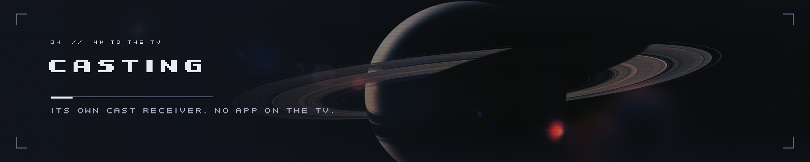</p>

<sup>[(Back to top)](#table-of-contents)</sup>

**Press `c`, pick the television, and the film moves there.** The TV runs codec's custom Google Cast receiver, so it wears codec's visual style: the dock, the loading hold, and the paused card over the film's hero art, all in the same pixel style as the app.

<p align="center">
  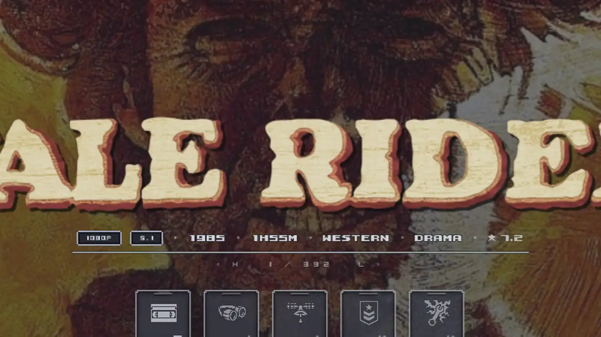
  <br>
  <i>Pick the TV, and the film moves there: codec's loading screen, then the dock. Recorded from the Bravia itself.</i>
</p>

<p align="center">
  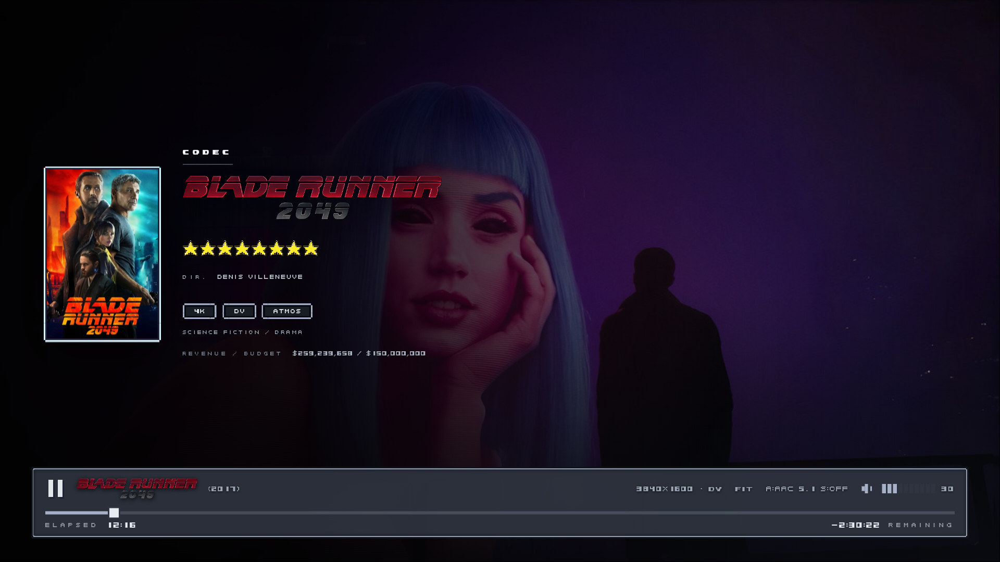
  <br>
  <i>A real capture from a Sony Bravia: paused, the film's card over its hero art.</i>
</p>

| | |
|---|---|
| 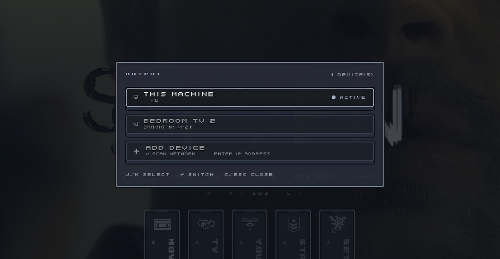 | 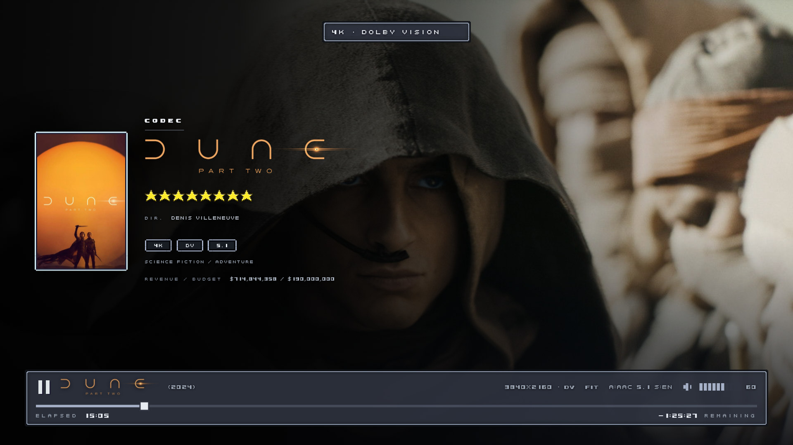 |
| **Pick a screen**: this machine, any Cast television, or ADD DEVICE by scan or address. | **Every film gets its card**: poster, title logo, badges, director, box office. (From the receiver's preview rig.) |

- **The TV's own remote drives codec**: play, pause, seek, audio and subtitle tracks, skip intro, up next
- **Captions drawn by the receiver**, in your style, on every lane, with real-time size adjustment via settings.
- **Subtitles fetched mid-cast**, with no restart; never go looking for subtitles again with codec.
- **The public receiver** at [ciphernovaa.github.io/codec/cast/receiver](https://ciphernovaa.github.io/codec/cast/receiver/), or [host your own](docs/CAST-RECEIVER.md)
- **How it works**, lane by lane: [docs/CASTING.md](docs/CASTING.md)

<br>

<a id="watch-party"></a>
<p align="center">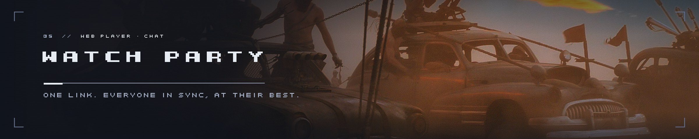</p>

<sup>[(Back to top)](#table-of-contents)</sup>

**Send one link. Everyone watches the same scene.** Friends open it and land in codec's own web player: the same dock, the same type, live chat, in sync with you. No install, no account. A guest's television can join too, in 4K HDR or Dolby Vision. Enjoy seamless mixed-format queues with friends. Set up a movie night with trailers, or just hang out from afar.

<!-- MEDIA: a guest's phone or laptop on the web player, and the invite unfurled in a chat app. -->
<p align="center">
  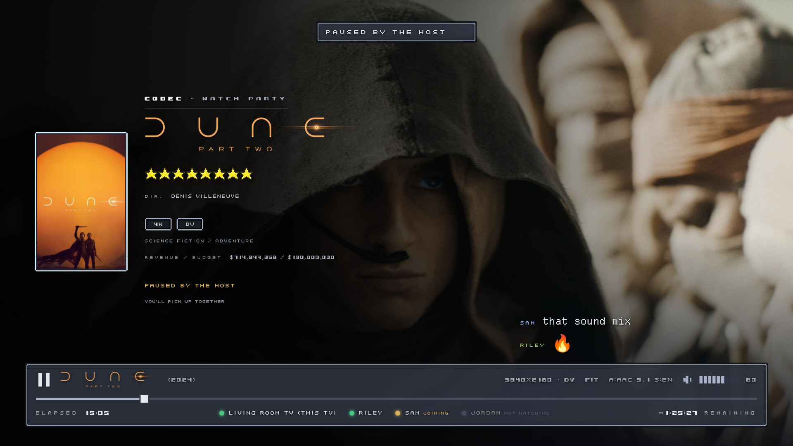
  <br>
  <i>Paused by the host. Chat in the corner; every seat in the dock.</i>
</p>

| | |
|---|---|
| 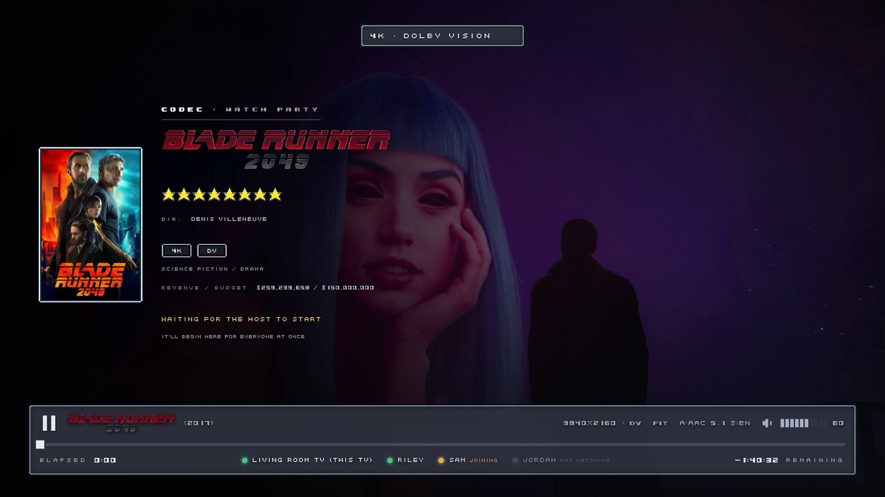 | 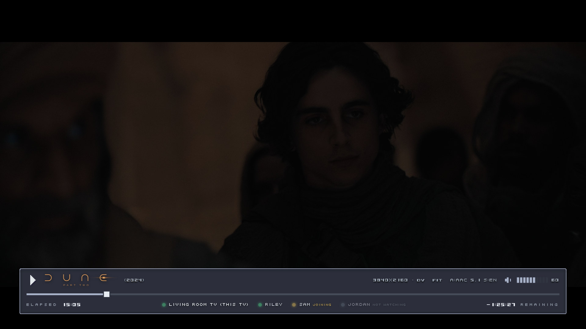 |
| **Joining**: everyone holds on the film's card until the host starts it, never do the "3, 2, 1, play" again. | **Playing**: the dock shows who's watching, who's joining, who stepped away. |

<sub>The TV face above is codec's real receiver page, rendered in its headless preview rig with sample guests.</sub>

<p align="center">
  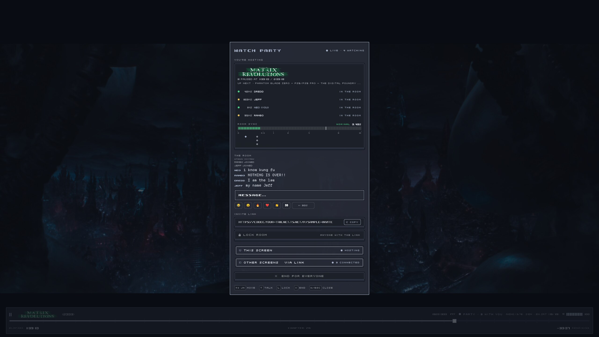
  <br>
  <i>Hosting from the app: who's in the room, how far apart the screens are, the chat, and the one link to send.</i>
</p>

- **Each guest climbs only as high as their device decodes**: a budget phone gets a stream it plays smoothly, a 4K TV the full picture.
- **Everyone waits to start together**: a new film holds every screen on "Loading for everyone", then the lights go down together
- **Seats**: present, seated, joining. Lock the room, drop a guest for absolute security.
- **Guests on the host's LAN** are offered the full-direct stream straight off the network.
- **The invite is the preview**: poster, logo and a live badge in any chat app
- **Vote to rewind**: `r` asks the room for 30 seconds back, and the hub rewinds when enough agree; a **ROOM SYNC** gauge shows the delay the room is holding, screen by screen.

The full guide: [docs/PARTY.md](docs/PARTY.md).

<br>

<a id="youtube"></a>
<p align="center">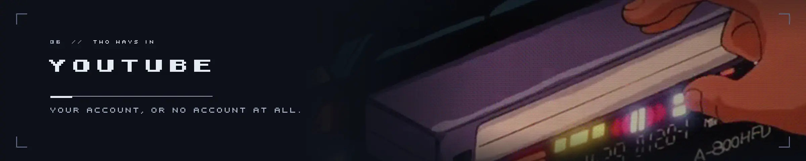</p>

<sup>[(Back to top)](#table-of-contents)</sup>

**YouTube, two ways in.** Use the login a browser on your machine already has: your recommendations, subscriptions, Watch Later, playlists, history and comments. Or use **codec's own lists**, no Google account at all: follows, playlists, history and a "FOR YOU" page of its own, without risking account security.

<p align="center">
  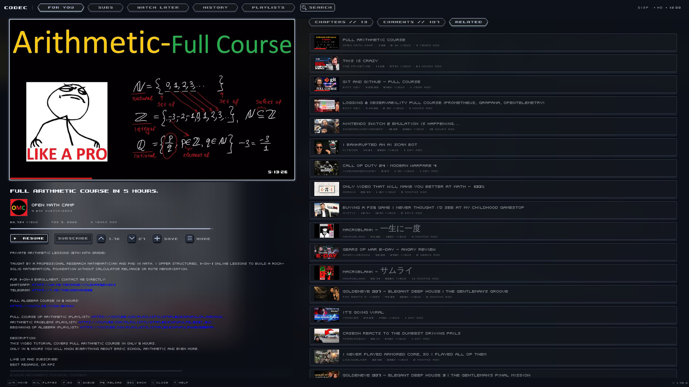
  <br>
  <i>Dedicated YouTube player: chapters, comments, related videos, and likes/dislikes (Return YouTube Dislike plugin).</i>
</p>

| | |
|---|---|
| 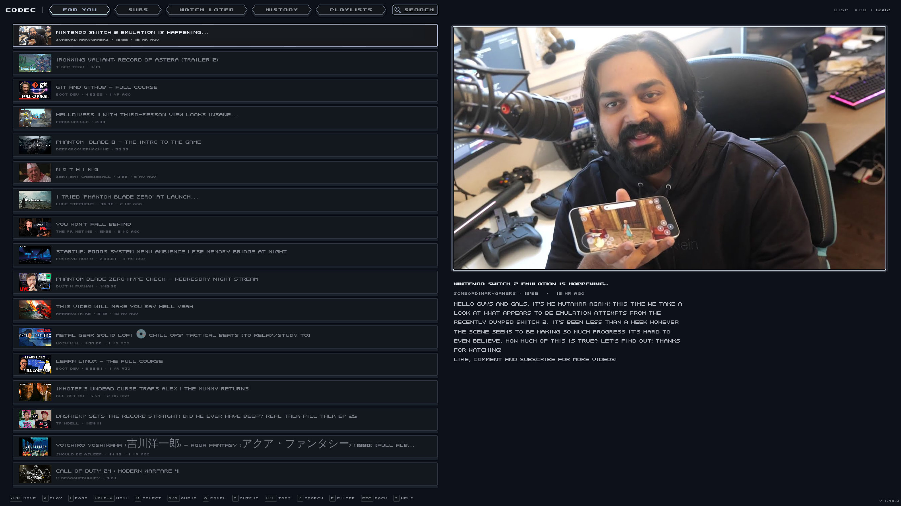 | 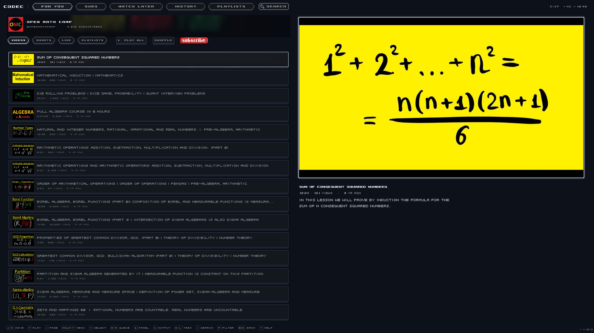 |
| **FOR YOU**, SUBS, WATCH LATER, HISTORY, PLAYLISTS: tabs, custom pins of your own alongside them | **Channels and playlists** get a header: tabs, PLAY ALL, SHUFFLE, PIN AS A TAB. |

- **Full livestream support** with a 4-hour rewind, and the live chat.
- **Select mode**: queue, save, remove or unsubscribe dozens at once for easy entertainment management.
- **Comments**: read and write YouTube comments.
- **Cast** any video to the TV, captions included, or **download it to the library** for offline viewing later.

The details: [docs/YOUTUBE.md](docs/YOUTUBE.md).

<br>

## Subtitles

<sup>[(Back to top)](#table-of-contents)</sup>

**Consistently correct.** codec fetches from several providers and judges every candidate: the right film, the right episode out of a season pack, the film's own runtime, clean text. Then it **re-times the winner against the film's own audio**, so a release cut for a different master still lines up.

- **Image subtitles** (PGS) become styled text by OCR, so every caption wears the same face.
- **One caption style everywhere**: the app, the TV's receiver, burned-in lanes, YouTube; size, font, colour and background, separately for this screen and the TV
- **Fetch while casting**, uninterrupted television playback without hunting for subtitles when a title is missing them.
- **Nudge the timing** with `X` / `C` in the player; codec remembers it per film for manual adjustments if needed.

<p align="center">
  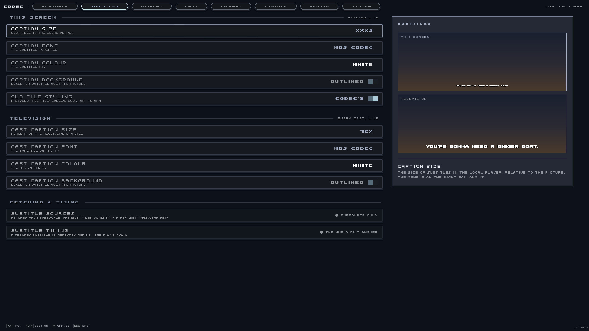
  <br>
  <i>Settings ▸ SUBTITLES: live samples for this screen and the TV.</i>
</p>

## Made for any viewing configuration

<sup>[(Back to top)](#table-of-contents)</sup>

**No keyboard required.** Every screen is compatible with Vim-style keyboard controls.
Additionally, your wireless mouse and Bluetooth remotes can be used.

- **The TV's own remote** drives codec while casting
- **A Bluetooth remote** maps key by key in Settings ▸ REMOTE; INPUT can move codec between screens, POWER sleeps the other one
- **The mouse is a remote**: the wheel walks, a tilt changes tabs, a click selects
- **A CRT is a first-class screen**: codec was built for both HD resolutions and 5:4 CRT monitors.
- **Close the laptop** while it casts and keep control from your television remote.
- **A phone app remote (experimental)**: a page the hub serves that searches the library, picks a screen, and plays, queues and seeks, allowing for truly on-the-go playback to friends' TVs.

## The queue

<sup>[(Back to top)](#table-of-contents)</sup>

**One line-up for every format.** A Dolby Vision film, a 1080p episode, a YouTube video and an HDR10 classic, back to back, each played in its own best format. Save a queue by name and load it on another night.

<p align="center">
  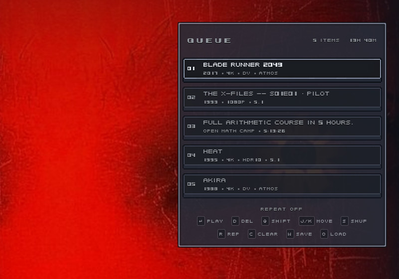
</p>

## Settings

<sup>[(Back to top)](#table-of-contents)</sup>

**Eight sections, every piece customizable.** ⏎ applies and esc cancels, so nothing changes by accident. A preview readout panel beside the options shows unsaved changes: caption samples, the dock corner, your remote's key mapping.

<br>

<a id="hub--satellites"></a>
<p align="center">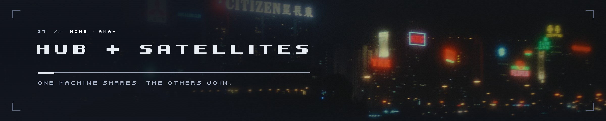</p>

<sup>[(Back to top)](#table-of-contents)</sup>

**One machine holds the library. Every other screen joins it.** Turn on **SHARE THIS LIBRARY** and the hub announces itself. On a laptop, pick **USE A CODEC HUB**; the hub's screen asks "LAPTOP WANTS TO JOIN · ⏎ ALLOW". That's the whole setup.

- **The hub keeps a lock**: paired devices only, unless you mark your network trusted; a stray web page gets media and nothing else
- **A satellite browses offline** from its own copy of the library and art
- **Away from home** it plays the hub's files at full quality, Dolby Vision included, or casts on the lane the hub picks, and steps down gracefully when the link can't keep up
- **One link model** (LAN, tailnet, a fast road, a relay) behind every call, probed in the background
- **RESUME HERE**: when another screen in the house is playing, press `e` and the film moves to this machine, at that moment, for seamless device switching without losing your watch position.

<br>

<a id="under-the-hood"></a>
<p align="center">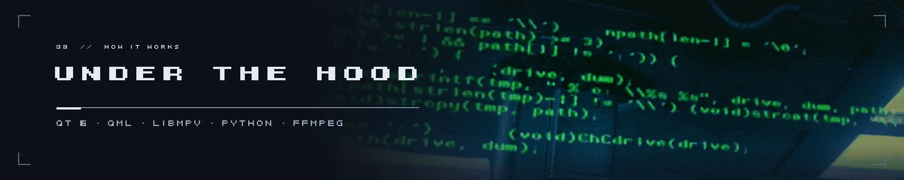</p>

<sup>[(Back to top)](#table-of-contents)</sup>

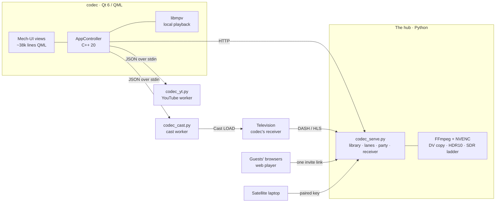

| | |
|---|---|
| **App** | C++ 20, Qt 6.5+ (Quick, Quick 3D, Shader Tools), libmpv, PipeWire, D-Bus/MPRIS · ~21k lines of C++, ~38k of QML |
| **Hub** | Python 3: one HTTP server for the library, the cast lanes, the party, the web player and the receiver; a cast worker; a YouTube worker · ~54k lines |
| **Video** | FFmpeg 8 with NVENC and libplacebo (Vulkan), `dovi_tool` and `mkvmerge` for Dolby Vision, shaka-player inside the receiver |
| **Data** | SQLite for resume and stats; a JSON manifest satellites pull; TMDB and fanart.tv for art |
| **Checks** | Python tests for the workers and the hub; an offscreen screenshot harness for every view at every screen size; a headless preview of the receiver in every state |

### Casting, under the hood

A cast is four programs cooperating: **the app** picks the TV; **a cast worker** speaks Google Cast and watches the cast; **the hub** decides the lane, runs the muxer or encoder and serves the segments; and **codec's receiver** on the TV plays them, draws codec's face and sends the remote's keys home. The lane comes from probing the file:

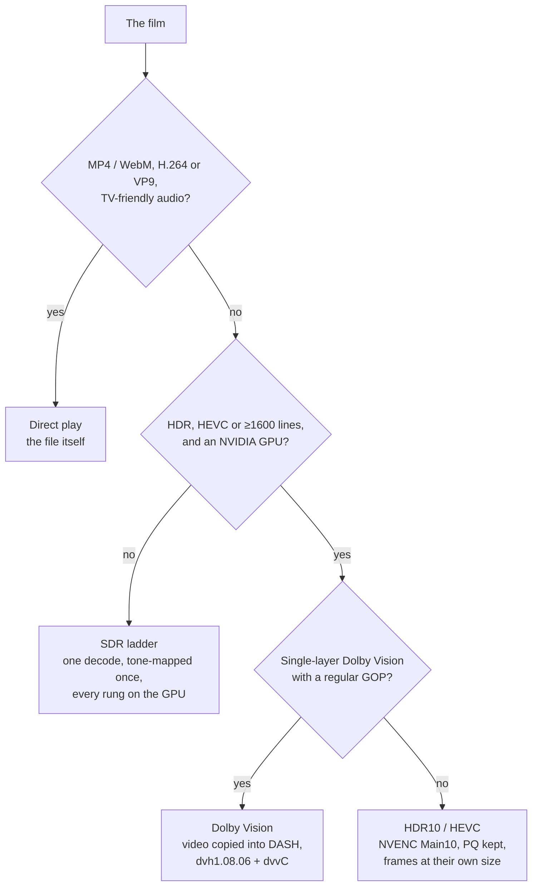

- **Dolby Vision is never re-encoded.** The film's own stream is cut on its GOPs into DASH; the hub patches the init segment's `dvvC` box, trims the first segment's RASL frames, and extends the manifest to the whole film from the film's real segment durations.
- **The buffer the Cast SDK doesn't expose**: its player merges a custom config, so the DV lane gets a buffering goal sized per film to fit the TV's ~165 MB of media memory, and fetches 2-second pieces in parallel.
- **The ladder is zero-copy**: Vulkan decode, libplacebo tone mapping, a hand-off to CUDA, `scale_cuda` for each rung, NVENC. No frame touches system memory.
- **It recovers on its own**: a worker watchdog and a receiver stall guard escalate from a nudge to a clean reload, and never give up.
- **Remote keys** go TV → hub → app in a 300 ms round trip.

The full walk-through, from the key press to the pixels: **[docs/CASTING.md](docs/CASTING.md)**.

How it all fits, the UI's rules and how to work on it: **[docs/DEVELOPMENT.md](docs/DEVELOPMENT.md)**. Everything codec does, area by area: **[docs/FEATURES.md](docs/FEATURES.md)**.

<br>

## Status

<sup>[(Back to top)](#table-of-contents)</sup>

| | Feature | Notes |
|---|---|---|
| ✅ | Library, info pages, local playback, HDR passthrough | Arch, Fedora 41, Debian 13 |
| ✅ | Casting: Dolby Vision, HDR10, SDR ladder, direct play | Verified on a Sony Bravia. HDR10 and the ladder need an NVIDIA GPU |
| 🧪 | Casting to other Cast televisions | Should work; tested on one set so far |
| ✅ | Watch party: web player, guests' TVs, chat | |
| ✅ | YouTube: both modes, video pages, livestreams | |
| ✅ | Subtitles: fetch, judge, re-time, OCR | Re-timing needs `ffsubsync` |
| ✅ | Multi-format queue, saved queues | |
| 🧪 | Hub & satellites on other people's networks | New in 1.48; tested in sandboxes |
| 🧪 | Garage editor | Off by default |
| 🛠 | YouTube player features | UP NEXT, SponsorBlock, seek previews, quality |
| 🛠 | Flatpak | Additional distribution support |
| 📋 | Windows | The entirety of codec, every feature: the app, the hub, casting, parties, YouTube. No partial port (significant development time needed)|

✅ works · 🧪 works, lightly tested · 🛠 in progress · 📋 planned

## Build from source

<sup>[(Back to top)](#table-of-contents)</sup>

codec needs **Qt 6.5 or newer** and **libmpv**. (Ubuntu 24.04's Qt 6.4 is too old; a Flatpak is coming.)

<details>
<summary><b>Arch / CachyOS</b></summary>

```sh
sudo pacman -S --needed cmake qt6-base qt6-declarative qt6-shadertools qt6-quick3d qt6-5compat \
    mpv libpipewire ffmpeg yt-dlp python-pillow python-pychromecast python-zeroconf python-ifaddr
```
</details>

<details>
<summary><b>Fedora 41</b></summary>

```sh
sudo dnf install cmake gcc-c++ qt6-qtbase-devel qt6-qtdeclarative-devel qt6-qtshadertools-devel \
    qt6-qtquick3d-devel qt6-qt5compat mpv-libs-devel pipewire-devel ffmpeg yt-dlp \
    python3-pillow python3-zeroconf python3-ifaddr python3-pip
pip install --user pychromecast     # Fedora doesn't package it
```
</details>

<details>
<summary><b>Debian 13 (trixie)</b></summary>

```sh
sudo apt install cmake build-essential qt6-base-dev qt6-declarative-dev qt6-shadertools-dev libmpv-dev libpipewire-0.3-dev \
    qml6-module-qtquick qml6-module-qtquick-window qml6-module-qtquick3d qml6-module-qtqml-workerscript \
    qml6-module-qtquick-shapes qml6-module-qtquick-effects qml6-module-qt5compat-graphicaleffects \
    ffmpeg yt-dlp python3-pil python3-pychromecast python3-zeroconf python3-ifaddr
```
</details>

**Then, in three steps:**

```sh
git clone https://github.com/CipherNovaa/codec.git && cd codec
cmake -B build -DCMAKE_BUILD_TYPE=Release && cmake --build build -j
./build/codec
```

**On first launch** codec asks which screen it lives on, then **CHOOSE MEDIA PATHS**: point it at your film and show folders. For posters and logos, paste a free [TMDB API key](https://www.themoviedb.org/settings/api) in Settings ▸ LIBRARY ▸ METADATA.

<details>
<summary><b>Optional, for the hub</b></summary>

| For | Needs |
|---|---|
| Casting HDR10 / the SDR ladder | An NVIDIA GPU (NVENC); FFmpeg 8.x (`scripts/setup_ffmpeg_static.sh` fetches a static build) |
| Dolby Vision files with irregular GOPs | `dovi_tool`, `mkvmerge` |
| Subtitle re-timing | `ffsubsync` in a venv at `~/.venvs/ffsubsync` |
| YouTube | `yt-dlp` and a JavaScript runtime (deno, node or bun) |
| Sharing the library, casting | Settings ▸ LIBRARY ▸ **SHARE THIS LIBRARY** (writes a systemd user service) |
| Watch parties outside the house | Tailscale Funnel, or your own name in front of the party port ([PARTY.md](docs/PARTY.md#what-the-hub-needs)) |
</details>

## Keys

<sup>[(Back to top)](#table-of-contents)</sup>

| Key | Does |
|---|---|
| arrows / `hjkl` | Move. `h` and `l` only ever move |
| `⏎` | Open, play, confirm. Hold it for more |
| `esc` | Back |
| `i` | The full info page, or a YouTube video's own page |
| `c` | Where it plays: this screen or a TV |
| `w` | Watch party |
| `q` | The queue |
| `/` | Search |
| `?` | Every key on this screen |

A TV remote works while casting, and a mouse or Bluetooth remote works everywhere.

## FAQ

<sup>[(Back to top)](#table-of-contents)</sup>

<details>
<summary><b>Is this another Plex / Jellyfin / Kodi?</b></summary>

It started as one house's Kodi replacement and became its own grand project. There are no server accounts and no web UI; it's a native player for your own library, with casting, parties and YouTube built in, and a look of its own.
</details>

<details>
<summary><b>Why does Dolby Vision need codec's own receiver?</b></summary>

Google's default Cast receiver doesn't play Dolby Vision or HDR reliably. codec's custom receiver is a static page that plays DV through Cast's own DASH stack, so the TV's Dolby Vision decoder engages, and it draws codec's face on the screen. See [docs/CAST-RECEIVER.md](docs/CAST-RECEIVER.md).
</details>

<details>
<summary><b>Do I need an NVIDIA GPU?</b></summary>

Only for the hub's HDR10 and SDR transcode lanes. Local playback, direct play and Dolby Vision casts (which copy the stream) don't need one. Additional hardware support is planned, but currently I only have NVIDIA to test with.
</details>

<details>
<summary><b>Which televisions are currently supported?</b></summary>

Anything with Google Cast: Chromecast, Google TV, Android TV sets. Dolby Vision needs a set that decodes it. Development happened on a Sony Bravia; other sets should work and reports are welcome. Additional smart television support such as Roku is in development.
</details>

<details>
<summary><b>Windows? macOS?</b></summary>

Not yet, and not as a cut-down version. Windows ships when **the entirety of codec** runs there: the app, the hub and its cast lanes, watch parties, YouTube, sharing and pairing. Qt, libmpv, FFmpeg, NVENC and Python all run on Windows; the work is the Linux-specific layer underneath (PipeWire audio, D-Bus and MPRIS, systemd services, the compositor calls, the hub's process handling), and it's mapped. macOS hasn't been looked at yet, and likely will be unsupported indefinitely. It depends on Apple's tolerance with this kind of thing.
</details>

<details>
<summary><b>Is the YouTube side allowed?</b></summary>

codec plays YouTube through yt-dlp, run as an external program, either with a browser's existing login or with no account at all. YouTube's terms don't welcome third-party players natively. More in [docs/YOUTUBE.md](docs/YOUTUBE.md).
</details>

## Roadmap

<sup>[(Back to top)](#table-of-contents)</sup>

- **The YouTube player**: UP NEXT and autoplay, SponsorBlock, storyboard seek previews, most-replayed, quality, translated captions and dubbed audio
- **Flatpak**: one package for every distro
- **Windows, feature full**: the app and the hub, casting, parties, YouTube, sharing; nothing left behind
- **A home of its own**: [ciphernovaa.github.io/codec](https://ciphernovaa.github.io/codec/)

## Contributing

<sup>[(Back to top)](#table-of-contents)</sup>

codec is a developer preview, so the most useful thing right now is **trying it on a machine that isn't the one it grew up on**, and saying what broke. [Open an issue](../../issues) with your distro, GPU and television. For code, read [CONTRIBUTING.md](CONTRIBUTING.md) and [docs/DEVELOPMENT.md](docs/DEVELOPMENT.md) first. Security reports: [SECURITY.md](SECURITY.md).

## About

<sup>[(Back to top)](#table-of-contents)</sup>

codec is designed and built by **[CipherNovaa](https://github.com/CipherNovaa)**: the C++ and QML app, the Python hub and its cast lanes, the Cast receiver and web player, and every pixel of the chrome. Also by the same author: **[twine-pc](https://github.com/CipherNovaa/twine-pc)**, a native PC port of *007: The World Is Not Enough* (PlayStation), decompiled to byte-identical C.

## Credits and legal

<sup>[(Back to top)](#table-of-contents)</sup>

The **MGS1 Codec / HUD** pixel fonts are Andrew Gleeson's (CC BY-SA 4.0), extended by codec. Icons are from game-icons.net (CC BY 3.0). The home globe is NASA imagery. Film data and art come from TMDB and fanart.tv: *this product uses the TMDB API but is not endorsed or certified by TMDB.* Everyone else is in **[CREDITS.md](CREDITS.md)**.

codec's visual style is in ways a fan's love letter to *Metal Gear Solid*. It isn't affiliated with or endorsed by Konami, and its UI sounds are an homage. The film stills in this README come from the author's own library, shown to demonstrate playback only. Support for acquiring media is not something I can ever assist with.

codec's code is released under the **GNU General Public License v3.0** ([LICENSE](LICENSE)). Fonts keep their own licences.
