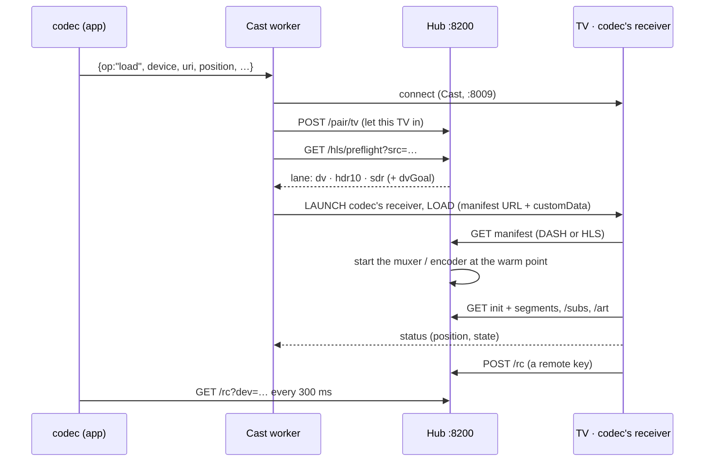

# How codec casts

codec puts a film from your disks on a Google Cast television at the quality it
was mastered in: Dolby Vision stays Dolby Vision, HDR10 stays HDR10, and the TV
shows codec's own face while it plays. This is how, from the key press to the
pixels.

**Contents:**
[The parts](#the-parts) ·
[A cast, end to end](#a-cast-end-to-end) ·
[Choosing a lane](#choosing-a-lane) ·
[The four lanes](#the-four-lanes) ·
[Seeking](#seeking) ·
[The receiver](#the-receiver) ·
[The remote, round trip](#the-remote-round-trip) ·
[Staying alive](#staying-alive) ·
[Casting from away](#casting-from-away) ·
[Party casts](#party-casts) ·
[The numbers](#the-numbers) ·
[Known edges](#known-edges)

---

## The parts

| Part | What it is | Where |
|---|---|---|
| **The app** | Picks the TV and the film, shows the cast remote, polls the TV's remote keys | `src/castmanager.*`, `src/appcontroller.*` |
| **The cast worker** | A long-running Python child of the app, one JSON op per line on stdin. Talks Cast (pychromecast, port 8009), decides direct play, builds the LOAD, watches the cast | `scripts/codec_cast.py` |
| **The hub** | Decides the lane, runs the encoders and muxers, serves manifests, segments, subtitles and art | `scripts/codec_serve.py` (port 8200 private, 8299 public) |
| **The receiver** | A web page the TV runs: codec's face, captions, the remote, buffer tuning, stall recovery | `_party_receiver()` in `codec_serve.py`, exported static by `scripts/codec_receiver_export.py` |

## A cast, end to end

1. **Pick the TV.** `AppController::setOutput` → `CastManager::setTarget`, which
   also sends `{op:"attach"}`: if another codec in the house already has a cast
   running on that TV, this one adopts it rather than starting over.
2. **Play.** `castPlay` fills in the title, poster and duration, and the resume
   point (dropped if it's under a minute or past the watched mark), then sends
   `{op:"load", device, uri, title, thumb, position, duration, subsize}` to the
   worker.
3. **The worker connects** to the TV and asks the hub to let it in
   (`POST /pair/tv`), so a hub that only answers paired devices serves this TV
   while it's being cast to.
4. **It probes the file**: picks the audio track (language preference, then a
   per-film choice), any forced subtitle, and a sidecar `.srt` if there is one.
5. **It decides whether the file can play as it is** (direct play), or asks the
   hub for a lane: `GET /hls/preflight?src=&aidx=&burn=`. If the preflight
   fails for any reason, the cast falls back to the SDR ladder rather than
   failing.
6. **It sends the LOAD**, launching codec's own receiver (app `C30E2505`, or a
   machine's own `party.castAppId`). Two tries 1.5 s apart; if the TV still
   refuses, the custom receiver is skipped for 20 s and the film plays on
   Google's default receiver instead. The film plays either way.
7. **The TV fetches** the manifest from the hub, then the segments, the
   subtitles (as WebVTT from `/subs`) and the art for its card.

What rides in the LOAD's `customData` matters as much as the URL:

| Field | Why |
|---|---|
| `dash`, `hdr`, `streamUrl`, `fullDur` | Which player path to use, and the whole film's length |
| `dvWarm` | Where a Dolby Vision lane's muxer started, so seeks know what's already produced |
| `dvGoal` | The buffering goal sized for this film (below) |
| `capUrl`, `capStyle` | Captions, drawn by the receiver in the caster's style |
| poster, logo, backdrop, `meta`, `ach`, `zoom` | The card, the dock, the audio channel count, the screen mode |
| `rcUrl`, `rcKey` | Where the TV's remote keys go, and the key that marks them as this cast's |

## Choosing a lane

One function decides, for the preflight and for the stream itself:
`cast_lane_decision(src, aidx, burn, want_dv)`. Its inputs come from probing the
file, not from the television:

- **HDR**: the transfer is PQ (`smpte2084`) or HLG. Ten-bit alone doesn't count.
- **Heavy**: the picture is 1600 lines or taller.
- **HEVC**: the video codec.
- **A subtitle burn**, and whether the hub has NVENC.

The rules:

1. **Use the GPU** when the film is HDR, heavy or HEVC, nothing is being burned
   in, and NVENC is there.
2. **Dolby Vision** if it's on the GPU, HEVC and HDR, and `dv_probe` passes: a
   single-layer DV stream (the RPU present in the first frames, no enhancement
   layer) with a **regular GOP** (keyframes in the first minute evenly spaced
   within ±0.05 s, and the film's midpoint still on that grid). An irregular
   GOP can't be cut into a clean DASH timeline; codec's DV toolkit re-encodes
   those files into a clean copy offline.
3. **HDR10 / HEVC** for everything else on the GPU.
4. **SDR ladder** otherwise.

**Direct play** is the worker's call, before any of that: an MP4, M4V, MOV or
WebM with H.264, VP8 or VP9 video, a first audio track in AAC, MP3, Opus,
Vorbis or FLAC, the default audio track, and nothing burned in. That file goes
to the TV untouched.

## The four lanes

### Dolby Vision: copied, never re-encoded

`hls_dv_dash_cmd` runs one continuous ffmpeg that **copies** the video stream
(`-c:v copy -tag:v dvh1`) and encodes only the audio to AAC, muxing DASH with
the segment length set to **the film's own GOP**, often 10 seconds. The video
the TV decodes is the studio's own Dolby Vision stream, bit for bit.

What the hub fixes on the way out:

- **The init segment** gets a `dvvC` box (profile 8, level 6, compatibility 1)
  and mastering-display / content-light boxes when the source lacks them; an
  edit list is stripped.
- **The first segment** drops its leading RASL frames, which reference pictures
  from before the cut.
- **The manifest** (`dv_dash_manifest`) says `codecs="dvh1.08.06"`, drops the
  muxer's runt first segments, and is **extended to the whole film**: the
  muxer has produced only a few segments when the TV first asks, so the rest of
  the timeline is filled in (`_dv_extend_timeline`). With an exact profile of
  the film's segment durations from an earlier complete cast, it's exact;
  otherwise it's an even fill at the encoder's nominal GOP with the count
  floored, so the manifest never runs ahead of the stream. (Averaging the first
  few segments instead once drifted 31 s by hour two: see
  [ENGINEERING.md](ENGINEERING.md#1-the-buffer-that-shrank-towards-the-end-of-the-film).)
- **Pieces.** Each 10-second GOP is served as ~2-second pieces
  (`DV_PIECE_TARGET`), so the TV can fetch several in parallel and ride out a
  stalled TCP stream.
- **Resuming mid-film**: the muxer starts at the keyframe at or before the
  resume point; the manifest gets placeholder segments for everything before
  it, and its origin is shifted so the film's clock still reads true.

Only one DV muxer runs at a time. Before answering the first request the hub
waits (up to 30 s) for the first video and audio segments to exist.

### HDR10 / HEVC: a GPU transcode that keeps PQ

`hls_hdr_video_cmd` decodes on the GPU (`-hwaccel cuda`) and encodes with
`hevc_nvenc` (`main10` for 10-bit sources, preset p4, 25 Mb/s, max 32), with an
IDR every 6 seconds and the colour tags carried through (BT.2020 / PQ for HDR,
BT.709 for SDR, set explicitly for untagged SDR). The HDR path has **no video
filters at all**, so frames go through at their own size: padding a non-2160
frame corrupts HDR on the TV. Audio is a separate continuous AAC encoder cut at
6.144-second boundaries and started a few segments early. The hub serves it as
DASH with each segment's timestamp patched to the film's clock.

### SDR ladder: one decode, every rung on the GPU

`build_ladder` takes the film's own height and the standard steps below it
(1080, 720, 480, 360, 240), never upscaling, up to six rungs, with bitrates
interpolated on a log curve (720p → 2.8 Mb/s, 1080p → 5.3, 2160p → 16; an HEVC
top rung × 0.65). `ladder_graph` decodes once and **tone-maps once**, at the
tallest rung, with libplacebo (`bt.2390`), then scales the lower rungs from
that.

With Vulkan decode the whole chain is **zero-copy**: Vulkan decode →
libplacebo on the GPU → hand the frame to CUDA (`hwupload=derive_device=cuda`)
→ `scale_cuda` for the rungs → `h264_nvenc`. No frame touches system memory.
Fallbacks: OpenCL tone mapping, then a CPU chain. 4-second TS segments, stereo
AAC. A solo cast is capped at 1080p (a Cast TV gets HDR from the HEVC lane);
party guests' browsers and phones climb the full ladder.

### Direct play

The file itself, from the hub, or from the worker's own small server (port
8205) for a file outside the hub's library. The importer remuxes files
"faststart" so a direct play begins at once.

## Seeking

- **SDR ladder**: the TV seeks natively, and the worker pre-warms the target.
  On the hub, a seek within 4 segments of what the running encoder has made
  waits for it; anything farther restarts the encoder at the seek point
  (throttled).
- **HDR10**: the same idea, with a 6-segment window, restarting 2 segments
  early so the TV lands on a segment that's ready.
- **Dolby Vision**: a seek more than 10 s away, or back before the muxer's
  start, **re-warms**: the receiver rewrites the manifest URL's warm point and
  reloads the stream there (debounced 450 ms, one at a time), and the hub
  restarts the muxer at the keyframe before the target. DV GOPs are open, so
  a far seek re-warms in either direction; with the deep buffer that takes
  about 11–14 seconds. That's a deliberate trade for smoothness once playing.
  A seek inside what's already produced is served from cache.

Warm points sit on a grid (`floor((t − 2.5) / 6)` for the DASH lanes, `t // 4`
for the ladder), so a cast resumed at nearly the same place reuses work.

## The receiver

- **The player path.** `customData.dash` → Cast's own DASH player (shaka); the
  TV's Dolby Vision and HDR decoders engage from the manifest's codec string
  and the init segment's boxes. Otherwise Cast's HLS player.
- **Playback settings**: resume after 8 s of buffer, pause below 2 s
  (`autoResumeDuration=8`, the fix for a seek micro-stutter).
- **The buffer, Dolby Vision only.** Cast exposes no setting for its player's
  buffer, but it merges a custom shaka config after its own defaults:
  `{streaming: {bufferingGoal, segmentPrefetchLimit: 4}}`. The goal comes from
  the hub (`dvGoal`): the film's bitrate against a 130 MiB budget, clamped to
  16–60 s, because the TV's media buffer tops out near 165 MB. If the TV ever
  reports its buffer full, the goal backs off by a quarter (never below 20 s).
  The other lanes keep Cast's default ~10 s: they race a live encoder and would
  ask for segments that don't exist yet.
- **Captions**: the receiver's own overlay, fetched as WebVTT (retrying while
  the hub converts a cold track), hidden while buffering, restyled live over a
  custom message channel (`urn:x-cast:com.codec.sub`; `.zoom` and `.toast`
  beside it).
- **The face**: the dock and the card, painted from the LOAD's art and facts; a
  same-film re-warm keeps what's painted.
- **Debug beacons**: the receiver posts its own state (buffered seconds,
  bandwidth estimate, dropped frames) to the hub, which logs it as `rx-dbg`.
  This is the telemetry every cast fix was measured with.

## The remote, round trip

The TV's own remote is codec's remote while it casts:

- **On the TV**: ← → seek ±10 s, ↑ ↓ ±60 s; the AUDIO key cycles audio tracks,
  CC toggles subtitles, `1` cycles them, CH± go to the next or previous item,
  red stops, green changes the screen mode; skip intro and up next have their
  own.
- **The trip**: the receiver posts `{key, op, arg}` to the hub's `/rc` (a queue
  capped at 32), and the app polls `GET /rc?dev=<uuid>` every 300 ms and acts
  on what it drains. The cast's own key (`rcKey`) keeps one TV's presses from
  driving another's cast.

## Staying alive

- **The worker's watchdog** (`_lane_watchdog`): a cast that never starts
  playing (18 s in, still under 3 s) is reloaded clean, the same as quitting
  the receiver and casting again. A playing clock frozen for 30 s, or 30 s of
  buffering, gets a recovery seek; repeats escalate to the clean reload at the
  current position. It never gives up.
- **The receiver's stall guard**: a still playhead with no buffer growth for
  7 s gets a nudge forward, then a re-warm (DV) or a reload of the same stream,
  backing off 30 / 60 / 120 s.
- **Encoders are reaped** asynchronously (ffmpeg reading from an NTFS drive can
  ignore SIGKILL for seconds); only one live encoder per lane, at most two NVENC
  sessions at once; an idle lane stops after 2 minutes and its spool is
  reclaimed after 15.
- **Fallbacks**: a source the GPU decoder refuses is test-decoded and sent
  through CPU decode into NVENC; 8-bit and 10-bit sources get their own pixel
  formats and profiles; a failed preflight goes to the ladder; a refused
  receiver goes to Google's.

## Casting from away

A satellite (a laptop away from home) casts through the hub's **public** port,
with a browse token and the film's **library index**, never a path:
`{public}/r/<token>/hls/preflight?i=<index>`, then the same DASH URL keyed by
`i`. The hub resolves the index itself. Without a lane, the satellite picks an
adaptive HLS stream capped to the TV's width. If the cast starves (25 s of
buffering within two minutes, or no picture 45 s in), it steps down to the
ladder for the rest of the film. The TV's remote keys need the private port, so
they don't reach the app while casting from away.

## Party casts

A guest's TV in a watch party builds no lane of its own. Its LOAD carries the
party's token, the hub's clock (`/p/<token>/state`) and the room's shared
stream (`/p/<token>/hls/pl`). The receiver follows the room's clock
(`position + (now − epoch)`), and its remote's seeks are posted to the room.
The shared stream is the party ladder (SDR plus up to two PQ rungs) or the
party's Dolby Vision lane, and the hub refuses requests that would drag the
room's encoder backwards. More in [PARTY.md](PARTY.md).

## The numbers

| | |
|---|---|
| Ports | 8200 hub (private) · 8299 public · 8205 worker self-serve · 8009 Cast |
| Segments | SDR ladder 4 s · HDR10 6 s (audio 6.144 s) · DV = the film's GOP, served as ~2 s pieces |
| Ladder rungs | native · 1080 · 720 · 480 · 360 · 240 (≤ 6) |
| HDR10 | HEVC Main10, 25 Mb/s, max 32 |
| DV buffer | 16–60 s from a 130 MiB budget; 4 pieces prefetched |
| Remote poll | 300 ms |
| Lane life | idle stop 2 min, spool reclaimed at 15 min, 2 NVENC sessions |
| Library result | 24 / 24 DV titles at full bitrate, 139 / 139 others, on a Sony Bravia |

## Known edges

- **A far Dolby Vision seek takes 11–14 s** to re-warm, by design (above).
- **A DV cast starting deep into a film** is the slowest start of all: the
  muxer begins at the keyframe there, and a cold drive has to deliver it.
- **The TV's remote keys don't reach the app** when casting from away.
- **The receiver labels a DV cast's HDR type as HDR, not DV** (a cosmetic field;
  the TV engages Dolby Vision from the stream itself).
